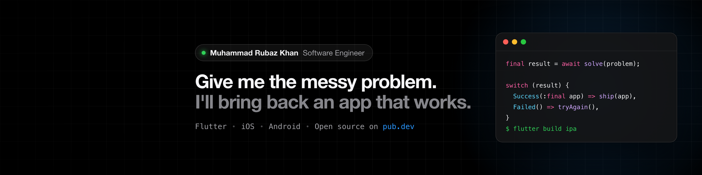

# Muhammad Rubaz Khan

**Software Engineer | Flutter, iOS and Android**

I'm a software engineer from Pakistan with 4+ years of building mobile apps that people rely on every day: booking bus seats for Umrah trips, renewing engineering licences, keeping families close to parents in care. I work across the whole app, from the first screen to the store release, and I like the messy problems most.

I also maintain **brix**, a family of six open-source Flutter packages on pub.dev, built from the code I kept rewriting for every app.

<p align="center">
  <a href="https://rubazkhan.vercel.app"></a>
  <a href="https://linkedin.com/in/rubaz-jamshaid"></a>
  <a href="mailto:rubazjamshaid@gmail.com"></a>
  <a href="https://pub.dev/packages?q=brix"></a>
  <a href="https://medium.com/@rubazjamshaid"></a>
</p>

## At a glance

| Experience | Apps | Countries | Open source |
|:---:|:---:|:---:|:---:|
| **4+ years** | **7 apps** | **4 countries** | **6 packages** |
| shipping mobile apps since 2022 | released on the App Store and Google Play | Pakistan, Saudi Arabia, Australia, US | published on pub.dev, MIT licensed |

## Open source: brix

[brix](https://github.com/mrubaz/brix) gives a Flutter app the parts every app needs, so the time goes into the features that matter. Login, signup, email codes, password reset, profile, delete account, API calls, safe storage and a full UI kit, all tested and documented.

Starting a new app:

```bash
dart pub global activate brix_cli
brix create my_app
```

Already have an app? Add only the packages you need.

| Package | What it does | pub.dev |
|---|---|---|
| [brix_cli](https://pub.dev/packages/brix_cli) | `brix create` makes a working app with every package wired in, a local test backend for debug builds, env configs and VS Code launch setups. `brix id` changes the app id on every platform. |    |
| [brix_ui](https://pub.dev/packages/brix_ui) | Buttons, text fields, code boxes, select and search, sheets, dialogs, toasts and loaders. Light and dark themes, customizable through tokens, theme, per-widget style or a full builder. |    |
| [brix_getx](https://pub.dev/packages/brix_getx) | A ready GetX controller for every flow (login, signup, codes, forgot and reset password, change password, profile, delete account, session), so the screen only draws the UI. |    |
| [brix_network](https://pub.dev/packages/brix_network) | Dio calls that return a typed result instead of throwing. Retries, timeouts, uploads, downloads, cancel, one logout on 401 and a readable log with secrets hidden. |    |
| [brix_storage](https://pub.dev/packages/brix_storage) | Values and secrets in Keychain or Keystore, a session store and offline lists. Safe after a reinstall or a broken keystore. |    |
| [brix](https://pub.dev/packages/brix) | The pure Dart core: auth and account flows, Result and Failure, Json helpers, a logger and test fakes. Works with any backend and any state library. |    |

Every package runs through CI on each change. Guides and live numbers are on the [brix website](https://rubazkhan.vercel.app/en/brix). Found a bug or have a question? Open an issue on the [brix GitHub issues page](https://github.com/mrubaz/brix/issues).

## Selected apps

| App | The problem | What I built | Links |
|---|---|---|---|
| **PEC Live**<br><sub>Pakistan Engineering Council</sub> | Engineers had to visit offices and deal with paperwork to renew their membership. | Membership renewal in a few taps, degree endorsement tracking, a digital e-card anyone can verify. Official app for 1,000+ engineers.<br><sub>Flutter, Provider, REST APIs, Firebase FCM</sub> | [PEC Live on Google Play](https://play.google.com/store/apps/details?id=com.pecit.pec) |
| **Rel8.app**<br><sub>Australia</sub> | Families wanted to see how their parents were doing in care, not hear it once a week on the phone. | Stories feed from care homes, secure messaging and video calls, daily wellness check-ins.<br><sub>Flutter, Firebase, WebRTC</sub> | [Rel8.app on the App Store](https://apps.apple.com/au/app/rel8-app/id1596771971)<br>[Rel8.app on Google Play](https://play.google.com/store/apps/details?id=com.rel8.app) |
| **Jannat Al-Ard**<br><sub>Saudi Arabia</sub> | Donors paid for free Umrah bus trips, but seats and schedules were managed by hand. | Live seat booking, trip schedules and routes, donor tracking.<br><sub>Flutter, Maps, Firebase FCM</sub> | [Jannat Al-Ard on the App Store](https://apps.apple.com/us/app/id6740854279)<br>[Jannat Al-Ard on Google Play](https://play.google.com/store/apps/details?id=com.akbar.barakahUmrah) |
| **Renew Fitness** | A fitness brand wanted members to follow plans, track progress and pay inside one app. | Workout plans and progress tracking, trainer content, subscriptions on iOS and Android.<br><sub>Flutter, in-app purchases, subscriptions</sub> | [Renew Fitness on the App Store](https://apps.apple.com/us/app/renew-fitness/id6504458241) |
| **Classify** | Students were juggling homework, calendars and class chats across too many apps. | Homework and calendar planner, class chat, AI study help and a focus timer.<br><sub>Flutter, OpenAI</sub> | [Classify on Google Play](https://play.google.com/store/apps/details?id=com.principal.classify) |
| **Flecso** | A fleet company was tracking trucks, containers and trips on paper and phone calls. | Driver and manager roles, live trip tracking on the map, trip milestones and QR codes.<br><sub>Flutter, Maps, roles, live tracking</sub> | [Flecso on Google Play](https://play.google.com/store/apps/details?id=com.techverdi.flecso) |
| **PollYa** | People wanted to share their opinion on the news, not just scroll past it. | Opinion polls on live news, on-device text recognition, AI summaries of articles.<br><sub>Flutter, ML Kit, LLM API</sub> | [PollYa on Google Play](https://play.google.com/store/apps/details?id=com.pollya.pollingapplic) |

## Experience

| Company | Role | Period |
|---|---|---|
| **BH Group** | **Software Engineer.** Building mobile apps and the shared Flutter packages they run on. Writing the tests and CI that every tester build goes through. | Aug 2026 to present |
| **!Failure** | **Software Engineer**, part-time, remote. Flutter apps from the first screen to the store release. | Nov 2025 to present |
| **Pakistan Engineering Council**<br><sub>Islamabad</sub> | **Software Engineer**, contract. Sole Flutter developer on PEC Live, the council's official app for 1,000+ engineers. Push notifications, REST APIs and releases on both stores. | Aug 2025 to Feb 2026 |
| **Sapphire Technologies**<br><sub>Lahore</sub> | **Software Engineer.** Cross-platform apps for clients in Saudi Arabia, Australia and the US. Shipped four apps to the App Store and Google Play. Recognised by the company for product delivery. | Jul 2023 to Jul 2025 |
| **Fantech Labs**<br><sub>Okara</sub> | **Associate Software Engineer.** Features, bug fixes and code reviews in a Scrum team. Worked on Rel8.app with designers and backend engineers. | May 2022 to Jun 2023 |

## Skills

<h3 align="center">Mobile</h3>
<p align="center">
  
  
  
  
  
  
</p>

<h3 align="center">State and architecture</h3>
<p align="center">
  
  
  
  
  
</p>

<h3 align="center">App features</h3>
<p align="center">
  
  
  
  
  
  
  
</p>

<h3 align="center">AI</h3>
<p align="center">
  
  
  
  
</p>

<h3 align="center">Backend and data</h3>
<p align="center">
  
  
  
  
</p>

<h3 align="center">Web</h3>
<p align="center">
  
  
  
  
  
  
</p>

<h3 align="center">Quality and release</h3>
<p align="center">
  
  
  
  
  
  
  
  
</p>

## How I work

**I ask a lot of questions first.** Who is using it? On what phone? With what kind of internet? Half the bugs I've seen started because nobody asked.

**I write the boring parts once.** Login, API calls, saving data. I got tired of rewriting them for every app, so I turned them into packages. That's how brix started.

**I test it like it's going to break.** On a slow network, with a tired user, it will. Better I find it than they do.

## Contact

<p align="center">Open to interesting mobile work. The best way to reach me is by email or LinkedIn.</p>

<p align="center">
  <a href="https://rubazkhan.vercel.app"></a>
  <a href="https://linkedin.com/in/rubaz-jamshaid"></a>
  <a href="mailto:rubazjamshaid@gmail.com"></a>
  <a href="https://pub.dev/packages?q=brix"></a>
  <a href="https://github.com/mrubaz/brix"></a>
</p>
